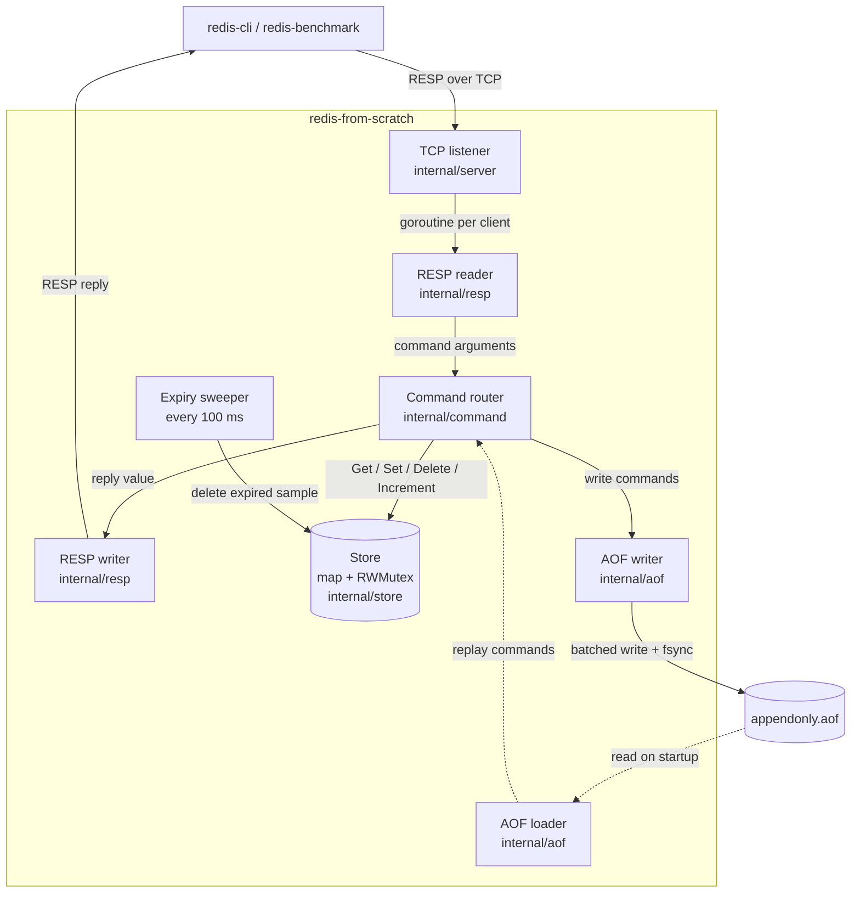

# redis-from-scratch

[](https://github.com/LewzzJrs/redis-from-scratch/actions/workflows/ci.yml)


A Redis-compatible key-value server written in Go using only the standard library. It works with the real `redis-cli` and `redis-benchmark`, and persists data to an append-only file.

## Demo


## Features

- **RESP protocol** parser and encoder, including pipelining and inline commands
- **Concurrent clients**, one goroutine per connection, with graceful shutdown on `SIGINT`/`SIGTERM`
- **Commands:** `PING`, `ECHO`, `SET` (with `EX`, `PX`, `EXAT`, `PXAT`), `GET`, `DEL`, `EXISTS`, `KEYS`, `INCR`, `DBSIZE`
- **Key expiry**, both lazy (checked on every read) and active (a background sweeper using Redis's sampling algorithm)
- **AOF persistence** with group commit, `always`, `everysec`, and `no` fsync policies, crash recovery, and corruption detection
- **Glob matching** for `KEYS` that follows Redis rules (`*`, `?`, `[abc]`, `[^a]`, `[a-z]`, `\` escapes)
- **9.9 MB Docker image** built on distroless, running as a non-root user
- **CI** with the race detector, fuzzing, Windows tests, and an end-to-end test using the real `redis-cli`

## Quick start

### With Docker

```bash
docker compose up -d --build
docker compose run --rm cli
```

```
redis:6379> SET greeting "hello world"
OK
redis:6379> GET greeting
"hello world"
redis:6379> SET otp 123456 EX 30
OK
redis:6379> INCR visits
(integer) 1
redis:6379> KEYS *
1) "greeting"
2) "otp"
3) "visits"
```

Data is stored in the `redis-data` volume and survives `docker compose down`. Use `docker compose down -v` to delete it.

### From source

Requires Go 1.27 or newer.

```bash
go run ./cmd/server
```

Then connect with any Redis client, for example `redis-cli -p 6379`. If `redis-cli` is not installed locally:

```bash
docker run --rm -it redis:7 redis-cli -h host.docker.internal
```

### Options

| Flag | Default | Description |
|---|---|---|
| `-port` | `6379` | TCP port to listen on |
| `-aof` | `appendonly.aof` | Path of the append-only file. Pass an empty string to keep data in memory only. |
| `-appendfsync` | `everysec` | When to fsync the AOF: `always`, `everysec`, or `no` |

## Supported commands

| Command | Behavior |
|---|---|
| `PING [message]` | Replies `PONG`, or echoes `message` |
| `ECHO message` | Replies `message` |
| `SET key value [EX seconds \| PX milliseconds \| EXAT unix-seconds \| PXAT unix-milliseconds]` | Stores a string. A plain `SET` removes any previous expiry. |
| `GET key` | Returns the value, or nil if the key is missing or expired |
| `DEL key [key ...]` | Deletes keys and returns how many existed |
| `EXISTS key [key ...]` | Counts existing keys; repeated keys are counted again |
| `KEYS pattern` | Lists keys matching a glob pattern |
| `INCR key` | Atomically increments an integer and keeps the key's expiry |
| `DBSIZE` | Number of keys in memory, including expired keys the sweeper has not reached yet |

Error messages match Redis, for example `ERR wrong number of arguments for 'get' command` and `ERR value is not an integer or out of range`.

## Architecture



| Package | Responsibility |
|---|---|
| `cmd/server` | Parses flags, restores the AOF, wires the packages together, handles shutdown signals |
| `internal/server` | Accepts TCP connections, runs one goroutine per client, holds replies until writes are durable, tracks connections for graceful shutdown |
| `internal/resp` | Reads and writes the Redis Serialization Protocol |
| `internal/command` | Command table with arity checks, the command handlers, write ordering for the AOF, and per-connection sessions |
| `internal/store` | Thread-safe key-value map with expiry deadlines and the background sweeper |
| `internal/aof` | Append-only file writer with group commit and fsync policies, and the loader that replays it |
| `internal/glob` | Redis-compatible glob matching for `KEYS` |

Each package has a single job and depends only on the ones below it. The store knows nothing about RESP or TCP, and the server knows nothing about individual commands.

## Technical challenges

### 1. Parsing RESP correctly and safely

RESP looks simple, but a server has to handle input that arrives in arbitrary chunks, several commands in one packet (pipelining), and clients that send garbage.

- **Bulk strings are read by length, not by searching for `\r\n`.** `$5\r\nhello\r\n` means "read exactly 5 bytes", so values may contain `\r\n` or any binary data.
- **Truncated input is different from malformed input.** The reader returns `io.ErrUnexpectedEOF` when a message stops halfway and a `ProtocolError` when its format is wrong. The AOF loader depends on this difference to tell a crash from corruption.
- **Replies are flushed only when no pipelined command is waiting.** 100 pipelined `PING`s produce one network write, not 100.
- **Untrusted lengths are not trusted.** Fuzzing showed that an 18-byte header like `$536870912\r\n` made the parser allocate 512 MB before any payload arrived. Large payloads are now read incrementally, so memory grows only with bytes actually received. Limits on line length, array size, and nesting depth cover the other ways a client could exhaust memory or the stack.

### 2. Lazy and active expiry

Each key stores an absolute deadline instead of a countdown, so checking expiry is a single time comparison.

- **Lazy expiry:** every read checks the deadline and hides expired keys. Deleting an expired key requires upgrading from a read lock to a write lock, and another client can write a fresh value in between. The deletion therefore re-checks the deadline after taking the write lock, so it never removes a value written in that gap.
- **Active expiry:** lazy expiry alone leaks memory for keys that are never read again. A background sweeper runs Redis's algorithm every 100 ms: sample 20 keys that have a TTL, delete the expired ones, and repeat if more than 25% were expired. Each cycle is capped at 25 ms, and the lock is released between samples, so the sweeper never blocks clients for long.
- **Sampling for free:** keys with a TTL are tracked in a separate index, and Go randomizes map iteration order, so taking the first 20 keys of a `range` loop gives a random sample without a random number generator.
- **Testable time:** the store reads time through an injected clock, so tests advance time instantly instead of sleeping.

### 3. Append-only file persistence

Writing commands to a file is easy. Making sure the file rebuilds exactly the same state after a crash is the hard part.

- **Write order must match apply order.** If two clients `SET` the same key, the order in the file must equal the order applied in memory. Write commands therefore hold an ordering lock while they update the store and append to the AOF. Reads skip this lock and stay parallel.
- **Group commit keeps the disk out of the lock.** Inside the lock, a write only encodes itself into an in-memory buffer and gets a sequence number. One background goroutine writes the whole buffer with a single `write()` and, under `appendfsync always`, a single `fsync`, then marks that range as durable. Each connection's output passes through a gate that waits until its latest write is durable before any reply reaches the socket, so a client never sees `OK` for data that could still be lost. In a test, 1,000 durable writes from 50 clients needed 40 fsyncs instead of 1,000, and `appendfsync always` became 22× faster.
- **Replay must be deterministic.** `SET key value EX 60` is recorded as `SET key value PXAT <absolute ms>`, so a key expires at the same moment no matter when the server restarts. `INCR` is recorded as a `SET` of its result, because replaying `INCR` on a key that expired in the meantime would restart the counter without its TTL.
- **Crashes are recovered, corruption is refused.** If the last command was cut off mid-write, the loader truncates the file to the last complete command, logs a warning, and starts. If a damaged command is followed by valid ones, the server refuses to start rather than silently lose data, and reports the byte offset.
- **One code path for everything.** The loader replays commands through the same router that serves clients, with logging turned off, so validation is identical and replay never writes the commands back to the file.

## Benchmarks

Measured with `redis-benchmark` 7.4 against Redis 7.4.12, both with AOF enabled (`appendfsync everysec` unless noted), on the same Docker network: 50 clients, 200,000 requests, median of 3 runs, on an AMD Ryzen 7 4800H.

| Command | Pipeline | redis-from-scratch | Redis 7.4 | Relative |
|---|---:|---:|---:|---:|
| SET | 1 | 38,358 ops/sec | 59,242 ops/sec | 65% |
| GET | 1 | 40,136 ops/sec | 59,970 ops/sec | 67% |
| SET | 16 | 371,747 ops/sec | 419,287 ops/sec | 89% |
| GET | 16 | 552,486 ops/sec | 598,802 ops/sec | 92% |
| SET, `appendfsync always` | 1 | 11,068 ops/sec | 12,107 ops/sec | 91% |

The first version fsynced every command on its own and reached only 4% of Redis with `appendfsync always`, and 46% for pipelined SET. Group commit brought these to 91% and 89%. Without pipelining, per-request overhead and the network round trip dominate. See [docs/benchmarks.md](docs/benchmarks.md) for the before-and-after comparison, run-to-run variation, the analysis, and how to reproduce the results with `bash scripts/benchmark.sh`.

## Testing

```bash
go test ./...
```

| Package | Coverage |
|---|---:|
| `internal/glob` | 100% |
| `internal/store` | 100% |
| `internal/command` | 99.1% |
| `internal/resp` | 98.5% |
| `internal/aof` | 90.1% |
| `internal/server` | 86.4% |

The test suite includes:

- **Fuzz tests** for the RESP reader, the bulk string round trip, and glob matching (`go test ./internal/resp -fuzz FuzzReadCommand`)
- **Concurrency tests** that run under the race detector in CI, such as 50 goroutines incrementing one counter, which must end at exactly 5000
- **Crash recovery tests** that cut an AOF command at every possible byte and check that the loader recovers
- **Benchmarks** for the parser, store, and glob matcher (`go test -run '^$' -bench . ./internal/...`)

CI runs on every push: formatting, `go vet`, tests with `-race` on Linux, tests on Windows, 20 seconds of each fuzz target, and an end-to-end test that starts the Docker image, writes data with the real `redis-cli`, restarts the container, and checks that the data survived.

## Limitations

- Only the string type is supported. Lists, hashes, sets, and sorted sets are not.
- The AOF grows forever. There is no rewrite or compaction like `BGREWRITEAOF`.
- If writing to the AOF fails, the server logs the error and keeps serving. Redis rejects further writes with a `MISCONF` error instead.
- No authentication, TLS, replication, transactions, or pub/sub.

## Project structure

```
.
├── cmd/server/            entry point
├── internal/
│   ├── aof/               append-only file writer and loader
│   ├── command/           command router and handlers
│   ├── glob/              KEYS pattern matching
│   ├── resp/              RESP reader and writer
│   ├── server/            TCP server and connection handling
│   └── store/             key-value store and expiry sweeper
├── scripts/benchmark.sh   reproducible benchmark against Redis 7
├── docs/benchmarks.md     full benchmark results and analysis
├── Dockerfile
└── docker-compose.yml
```

## What I learned

- **A protocol is mostly edge cases.** Parsing a well-formed `SET` is the easy part. Most of the parser deals with partial reads, pipelined commands, and binary values, and with telling a truncated message apart from a malformed one. Fuzzing found a bug I would never have thought to test: an 18-byte header could make the server allocate 512 MB.
- **Concurrent code needs evidence, not confidence.** Releasing a read lock and taking a write lock looks harmless until another client writes in between. Running the race detector on every change, and writing tests such as "50 goroutines increment a counter, the result must be exactly 5000", is what made me trust the locking.
- **Durability is a contract, not a file write.** Appending commands to a file is easy. Making a replay after a crash rebuild exactly the same state is not: relative TTLs have to become absolute timestamps, `INCR` has to be logged as its result, a cut-off last command has to be distinguished from corruption, and a client must not see `OK` before its write is durable.
- **Measure before claiming.** Comparing against real Redis showed that my first AOF reached only 4% of its speed with `appendfsync always`. Understanding why led me to group commit, which made it 22× faster. Running the benchmark more than once also taught me that numbers from a laptop vary, and that only results from the same run should be compared.
- **The Go standard library goes a long way.** TCP, buffered I/O, locks, fuzzing, benchmarks, and the race detector all come with Go. The whole server has no dependencies, and its Docker image is under 10 MB.

## License

[MIT](LICENSE)

